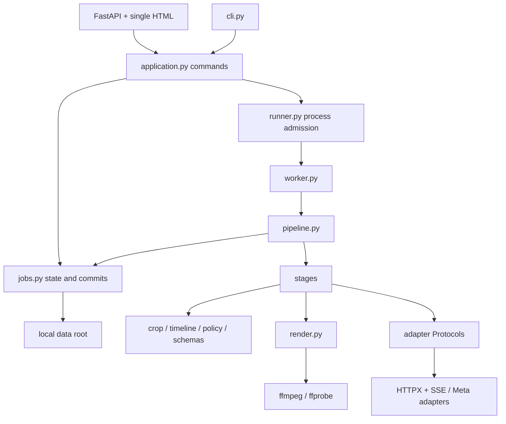

# Architecture Spine — AdLoom

검토를 마친 설계 기준선이다. 사용자 후속 요청으로 schemas.py의 공유 모델·순수 검증과 개발 검사 도구를 구현했다. 나머지 application 서비스·제품 API는 구현 전이다. 외부 재사용·설계는 SC-014, 스키마 구체화는 SC-015에 기록하며 root SPEC는 수정하지 않는다.

## Design Paradigm

**Layered modular monolith + ports/adapters.** 같은 Python 서비스가 CLI와 웹을 처리하고, 별도 로컬 worker가 긴 작업을 실행한다. 데이터 저장은 파일, 병렬 실행 제한은 OS lock, 미디어 실행은 ffmpeg다. 프레임별 Python 영상 복사·범용 workflow engine·외부 queue는 사용하지 않는다.



화살표는 허용 의존 방향이다. `schemas.py`는 다른 application 모듈을 import하지 않는다. provider와 renderer는 job 상태를 직접 쓰지 않는다.

## Invariants & Rules

### AD-1 — 공용 command 경계

- **Binds:** CAP-1~9, web/CLI/worker.
- **Prevents:** 웹 전용 승인·재개 로직과 CLI 로직의 분기.
- **Rule:** 모든 쓰기 명령은 application→jobs를 거친다. web은 HTTP 변환, CLI는 인자 변환만 한다. worker는 pipeline을 실행하고 pipeline만 단계 성공을 jobs에 commit한다. adapter는 Protocol 5개로 주입하며 provider 타입을 순수 계산 모듈에 노출하지 않는다.

### AD-2 — data-root 단위 단일 worker

- **Binds:** runner, jobs, web/CLI, 취소·재개.
- **Prevents:** 두 서버·CLI 동시 실행, 긴 lock으로 취소 불가, stale worker의 늦은 commit.
- **Rule:** data-root global flock→짧은 job lock 순서를 사용한다. global lock 획득 시 stale RUNNING/CANCEL_REQUESTED의 active_run_id를 회수한다. RUNNING commit 뒤 job lock을 풀고 fd를 worker에 상속한다. READY/GO handshake 이전에는 외부 작업 금지, timeout이면 owned child kill+wait와 fenced 복구를 한다. 모든 commit은 run_id/revision을 대조하고 취소 상태를 보존한다. 서버 시작·입장·취소의 lease 확인은 codebase §2를 따른다. busy409, 대기열 없음.

### AD-3 — 원자적 head와 불변 산출물

- **Binds:** jobs, 모든 단계, recovery.
- **Prevents:** 일부 파일만 기록된 상태의 승인, 두 개의 현재 revision, crash 뒤 무조건 재게시.
- **Rule:** `job.json`이 현재 상태·revision·manifest_seq와 불변 artifact manifest/approval의 참조를 가진다. 산출물·manifest·approval 파일을 먼저 fsync+rename한 뒤 job.json을 같은 filesystem에서 원자 교체한다. 고아 파일은 commit된 결과가 아니다. publish journal은 operation별 원자 기록이며 remote ID를 job 상태보다 먼저 보존한다. 원격 부작용이 있거나 결과 불명이면 journal을 대조하지 않고 단계 재실행하지 않는다.
- 정리는 global run lock 보유 중에만 하며 모든 revision/approval/journal 참조를 보존한다. 실행 중 고아로 보이는 미commit 파일을 삭제하지 않는다.

### AD-4 — content revision과 진행 sequence 분리

- **Binds:** CAP-6·8·9, API와 저장.
- **Prevents:** 진행 polling 때문에 매번 승인이 무효화됨, 두 검토자의 덮어쓰기, no-op 재렌더.
- **Rule:** 내용 편집은 base_revision을 요구하며 실제 내용이 달라질 때만 revision을 올린다. 진행·검토·산출물 commit은 manifest_seq를 올린다. review/approve는 base_manifest_seq까지 대조한다. 의미상 no-op는 두 값과 기존 승인 모두 유지한다. 편집→이전 승인 참조 제거→영향 산출물 무효화는 같은 job commit이다. renderer 완료만으로 content revision을 올리지 않는다.
- run_state가 실행 중이거나 PREPARED/CONFIRMED/UNKNOWN 게시 operation이 있으면 편집·review·approve를 거부한다. 편집 rollback과 재실행 예약은 AD-14의 확장 전이 계약을 따른다.

### AD-5 — 승인 snapshot과 외부 부작용 결합

- **Binds:** CAP-6·7·9, publish/approval.
- **Prevents:** 승인 후 payload 교체, 순환 digest, 응답 유실 뒤 중복 생성.
- **Rule:** digest는 schemas.ApprovalSubject의 명시 포함 목록으로만 만든다. 자산·문구·근거·검토·경고·fallback·origin_mode·고정 PublishPlan을 포함하고 manifest_seq/ref·PublishResult·remote IDs·journal·runtime 상태/시각은 제외한다. publish/게시 resume/reconcile은 base_revision과 화면에서 확인한 expected_approval_digest를 요구한다. 계정/Page/Graph/profile env가 승인 snapshot과 다르면409다. resource별 PAUSED 적용은 SC-001 승인 대상이다. PREPARED→CONFIRMED/UNKNOWN journal을 쓰고 UNKNOWN은 공용 reconcile 명령의 원격 read-back+운영자 확인으로만 연결하거나 abandon한다. 검색 결과 없음은 미생성 증거가 아니며 자동 재POST하지 않는다.

### AD-6 — 공식 SAM parser를 adapter 내부에서 재사용

- **Binds:** CAP-3·9, adapters/sam.py.
- **Prevents:** custom grammar 재구현, 좌표 +1 중복, incomplete 응답을 low coverage 성공으로 오인.
- **Rule:** meta-sam-parser0.1.0 root API만 사용한다. half-open right/bottom의 차이로 bbox를 만든다. completed+진단 검사를 통과한 zero-match만 coverage0이다. incomplete/transport/제한초과/refusal은 각각의 오류로 분류하고 schema repair로 묶지 않는다. SourceError/ParserError의 public cause를 검사한다. SAM 자동 repair는 없고 Spark 구조화 응답 수정 재요청만1회다.

### AD-7 — 좌표·시간·문자 인덱스의 단일 정의

- **Binds:** CAP-1~5·9, web seek와 모든 adapter.
- **Prevents:** MOV 회전 이중 적용, 자막 offset 드리프트, Python/JS 문자열 범위 불일치.
- **Rule:** audio/video를 동일0 기준으로 정규화한 MP4의 digest·크기·timebase를 Spark/SAM/Voice/render가 공유한다. 정수 time_us·rational fps·반개구간과 timeline.py의 frame_start_us/frame_at_us를 사용하고 JS에는 frame index와 중앙 seek 시각을 준다. bbox는 source half-open pixel, sampling 반올림은 renderer1곳이다. note는 NFC 후200codepoint 이하이며 JS Array.from 기준 span을 사용한다. EvidenceCandidate의 구조와 근거별 유효성 검사를 분리한다.

### AD-8 — dependency fingerprint 기반 선택적 재생성

- **Binds:** CAP-4~6·9, pipeline/render.
- **Prevents:** 카피 수정에 전체 모델 재호출, 이전 결과를 최신 결과로 표시, crop와 source seek의 시간축 불일치.
- **Rule:** stage fingerprint에는 관련 입력·설정·모델 snapshot·폰트·renderer build가 포함된다. 동일 artifact는 ID 재참조한다. 본문/제목은 영상 재사용, 훅은3개, object/구간/자막/카드CTA는 영향6개를 갱신하며 note는 이해부터 재실행한다. 기존 후보 선택은 SAM을 재호출하지 않는다. current6개와 필수 검토 완료 전 승인 금지, media와 source seek는 같은 TimelinePlan을 사용한다.

### AD-9 — 로컬 웹의 좁은 신뢰 경계

- **Binds:** CAP-1·5·6·8·9, web/artifact I/O.
- **Prevents:** 로컬 서버 CSRF·DNS rebinding·경로 탈출, 미디어 seek 직접 구현, 브라우저 토큰 유출.
- **Rule:** loopback bind, 허용 Host/Origin, HttpOnly SameSite 세션과 CSRF token을 사용한다. 상태 변경은 POST/PATCH만 허용한다. 모든 미디어 접근은 job/artifact ID를 manifest의 검증된 경로로 resolve하고 실제 경로를 data root 안에 제한한다. 영상은 Starlette FileResponse의 Range 지원을 재사용한다. 외부 CDN·브라우저 SDK·키 값 전달 없음. 단일 HTML과 로컬 JS/CSS만 제공한다.
- 미디어 resolve는 revision/manifest_ref까지 받는다. 이전 결과 비교 재생은 stale 표시와 함께 허용하되 current 다운로드 manifest에는 넣지 않는다.

### AD-10 — 외부 transport와 자원 상한

- **Binds:** adapters, 입력·정규화·renderer.
- **Prevents:** SSE 줄처리 오류, parser mask allocation 폭주, redirect로 임의 host 접근.
- **Rule:** HTTPX/httpx-sse를 사용하되 identity encoding과 public byte-stream wrapper에서 전체·물리line 상한을 먼저 적용한다. event 상한의 decode 후 검사 한계를 명시한다. parser source의 delta carry와 done 전체 text에 mask header quota를 적용한다. HTTP status를 SSE보다 먼저 분류한다. 업로드는 ASGI receive 앞단 상한·data/tmp spool을 강제한다. redirect 자동추적 금지, Image base64 우선, ffmpeg 인자 배열·로컬 protocol만 허용한다.

### AD-11 — fixture/live/replay의 명시적 분리

- **Binds:** CAP-1~9, config/adapter factory.
- **Prevents:** 키 오류를 mock 성공으로 대체, replay를 새 모델 실행·게시로 오인.
- **Rule:** job의 fixture/live mode는 생성 시 고정하고 artifact origin_mode를 승인 Subject에 포함한다. live 게시에는 live provider 출처 또는 같은 live 시도의 허용 fallback/skip만 쓸 수 있다. operation_key에 mode를 포함해 mock ID와 분리한다. replay는 출처·시각을 유지하는 read-only 채점/재생이고 publish하지 않는다. stage별 H2/H3/LIVE-OK와 env 자격을 검사하며 키 오류를 mock으로 대체하지 않는다.

### AD-12 — 재사용 provenance와 검증 범위

- **Binds:** 전체 코드베이스, 개발·평가·제출.
- **Prevents:** 두 parser 구현, 라이선스 누락, baseline smoke를 제품 완료로 보고.
- **Rule:** 실행 의존성은 pyproject+uv.lock으로만 설치하고 third_party 원본 source archive는 감사·재현용으로 둔다. 압축 source를 별도 sys.path에 추가하거나 동일 parser를 복제하지 않는다. 폰트·source의 commit/release·SHA256·라이선스는 manifest로 보존한다. 기존 AC21/BA18/PQ10은 최종 제품의 별도 검증이며 이번 baseline smoke와 구분한다. 고객 검증은 요구하지 않는다.

### AD-13 — Model Files lifecycle 소유권

- **Binds:** CAP-1~4·8, pipeline, adapters/files.py.
- **Prevents:** Spark가 지운 파일을 SAM이 재사용, ID 유실 뒤 원격 파일 누적, Image 검색으로 추가 처리.
- **Rule:** pipeline이 업로드 전 PREPARED·ID 수신 직후 CONFIRMED journal과 소비자 공유를 소유한다. 마지막 소비자 완료·실패·중단 cleanup에서 삭제하고 실패는 CLEANUP_REQUIRED다. 삭제된 ID를 재사용하지 않는다. UNKNOWN은 자동 재업로드하지 않으며 resume_job의 명시 new_upload_attempt로 잔존 동의·actor·이전 attempt를 보존한 뒤 새 업로드1회만 허용한다. Image 검색·웹검색·shell은 false다. 메커니즘은 codebase §3.1에 고정한다.

### AD-14 — 입력 확정·편집 전이·승인 predicate

- **Binds:** CAP-1·2·6·8·9, application/pipeline/jobs/policy.
- **Prevents:** 음성 전사의 자동 사용자 승인, 편집 뒤 잘못된 사업 상태, UI와 서버의 승인 조건 차이.
- **Rule:** 음성 note는 worker 전사 후 CREATED+REVIEW_REQUIRED에서 사용자 confirm_note를 기다린다. rollback은 표의 상한과 현재 완료 상태의 최솟값이고 실패·중단/pending_stage를 보존한다. 재계산은 입장 예약부터 하고 busy에는 무변경409다. UI/approve/publish는 approval_issues를 공유한다. fixture는 mock plan, live만 live gate를 적용한다. plan은 create/명시refresh/게시설정edit에서만 snapshot하며 env profile 교체는 명시refresh만 허용한다. approve/publish는 비교만 한다.


## Consistency Conventions

| Concern | Convention |
| --- | --- |
| 식별자 | job_id/run_id는 UUID hex, revision/manifest_seq는 증가 정수, artifact_id는 sha256과 kind. SAM object_id는 문자열 그대로 |
| 저장·오류 | UTF-8 JSON, UTC ISO8601 관측 시각, finite 숫자만; 외부 error detail은 비밀 제거 |
| Mutation | business state/run_state/revision/manifest_seq를 구분; unknown publish 상태는 사람 대조 필요 |
| 규칙·문구 | PyYAML safe_load 후 Pydantic 검증. 검토 필수 claim과 창작 inference를 구분하며 모델의 accepted 값은 거부 |
| 실행 환경 | macOS arm64 기준, local filesystem·POSIX flock; Windows/NFS는 지원 범위 밖 |

## Stack

| Name | Version |
| --- | --- |
| CPython | 3.12.15 |
| uv | 0.11.21 |
| FastAPI | 0.162.0 |
| Pydantic | 2.14.1 |
| HTTPX | 0.28.1 |
| httpx-sse | 0.4.3 |
| meta-sam-parser | 0.1.0 |
| Pillow | 13.0.0 |
| Uvicorn | 0.54.0 |
| python-multipart | 0.0.32 |
| PyYAML | 6.0.3 |
| ffmpeg / ffprobe | 9.0.2, Homebrew build provenance 기록 |

설치 핀·공식 근거는 dependencies companion과 uv.lock에 있다. ffmpeg 바이너리는 배포물에 동봉하지 않는다. 현재 빌드는 GPL/libx264 구성이다. 폰트의 파일 수준 핀은 third_party manifest가 정본이다.

## Structural Seed

schemas.py는 구현됐고 나머지는 구현할 위치다. 현재 모델 계약과 실행 확인은 docs/architecture/schemas.md, 서비스 API·저장은 codebase companion을 따른다.

```text
src/adloom/
  schemas.py  config.py  application.py  jobs.py
  runner.py   worker.py  pipeline.py     cli.py
  crop.py     timeline.py  policy.py    render.py
  adapters/base.py  adapters/spark.py  adapters/sam.py
  adapters/image.py  adapters/voice.py  adapters/marketing.py
  adapters/fixture.py  adapters/replay.py
  adapters/files.py
  stages/input.py
  stages/understand.py  stages/track.py  stages/enrich.py
  stages/assemble.py    stages/publish.py
  web/app.py  web/routes.py
  web/static/index.html  web/static/app.js  web/static/styles.css
```

웹 프로세스 1개와 실행 중 worker 최대1개가 같은 data root를 사용한다. browser는 provider에 직접 접속하지 않는다. 환경변수·권한은 worker 시작 시 필요한 provider에만 전달한다. public hosting·multi-tenant authentication·DB는 별도 범위다.

## Capability → Architecture Map

| Capability / Area | Lives in | Governed by |
| --- | --- | --- |
| CAP-1 입력 | application, input stage, voice, schemas, web/CLI, jobs | AD-1·3·7·9·10·11·13·14 |
| CAP-2 이해/정책 | understand, spark, policy | AD-1·7·10·11·13·14 |
| CAP-3 추적 | sam, track, crop | AD-6·7·8·10·13 |
| CAP-4 보강 | image/voice, enrich | AD-7·8·10·11·13 |
| CAP-5 렌더 | timeline, render, assemble, web media | AD-3·7·8·9 |
| CAP-6 승인 | application, jobs, policy | AD-2·3·4·5·9·14 |
| CAP-7 게시 | publish, marketing, jobs | AD-2·3·5·10·11 |
| CAP-8 실행/복구 | runner, worker, pipeline, jobs | AD-1·2·3·4·11·13·14 |
| CAP-9 근거/편집 | application, schemas, timeline, web | AD-4·5·6·7·8·9·14 |

## Deferred

- 광고 objective/optimization/billing/placement·최소 예산·Graph 버전·계정 권한은 H3에서 실제 조합을 확인한다. 값이 없으면 게시를 차단하며 architecture에서 임의 선택하지 않는다.
- 실제 모델 접근·비용·보관 동의는 H2, 사전 개발/외부 코드 허용·제출 방식은 H1/H4에서 해제한다. 외부 baseline 확보는 이 규정의 허용 확정이 아니다.
- 원본 AC-16의 모든 요청 PAUSED와 SC-001의 resource별 status는 충돌한다. SC-001 승인·원본 반영 전 live publish 구현의 수용 계약을 확정했다고 보지 않는다. 나머지 확장 전이도 SC-005·014 원본 반영 대상이다.
- 화면의 색·타이포그래피·세부 배치는 구현 시 결정한다. source seek·편집 범위·승인 차단·상태 표시는 기존 product-flow 계약에 고정되어 있다.
- 원격 심사 환경이 요구되면 local-only 신뢰 경계를 별도 검토한다. 현재 설계를 공개 인터넷에 그대로 노출하지 않는다.
