# AdLoom architecture

AdLoom is a single-process Python application (`src/adloom/`). One shared pipeline module (`src/adloom/pipeline.py`) is called by both the command-line interface (`src/adloom/cli.py`) and the local web app (`src/adloom/web/app.py`). Every external call goes through one of five adapter interfaces in `src/adloom/adapters/base.py`. Each interface has a mock implementation used by default and a live implementation that is gated behind configuration (see "Live gate" below).

## End-to-end flow

```mermaid
flowchart TD
    A["Owner uploads one video<br/>+ short note (typed or spoken)"] --> B["Normalize<br/>ffprobe/ffmpeg: rotation, start time,<br/>fps ≤ 30, even dimensions<br/>stages/input.py"]
    A -. "spoken note" .-> V0["Muse Voice transcribe<br/>owner confirms the text<br/>before it is used"]
    V0 --> B
    B --> C["Muse Spark 1.3 — understand<br/>strict JSON-schema output:<br/>key moments, 3 hooks, copy, CTA,<br/>SAM prompt, classified claims<br/>adapters/spark.py · stages/understand.py"]
    C --> C2["Local checks on Spark output<br/>schema validation (one repair retry),<br/>CTA allowlist, policy rule table<br/>with suggested rewrites<br/>policy.py · policy_rules.yaml"]
    C2 --> D["SAM 3.1 — track the product<br/>prompt = Spark's noun phrase,<br/>streamed response parsed with the<br/>official meta-sam-parser<br/>adapters/sam.py"]
    D --> E["Crop plans per ratio<br/>9:16, 4:5, 1:1 — interpolated boxes,<br/>bounded camera speed, center-crop<br/>fallback if coverage < 60%<br/>crop.py"]
    E --> F["Enrich<br/>Muse Image: text-free background<br/>for thumbnails and end cards (3 ratios)<br/>Muse Voice: transcript of the video's<br/>audio → subtitles<br/>stages/enrich.py"]
    F --> G["Deterministic ffmpeg render<br/>3 ratios × 2 hooks = 6 MP4s<br/>H.264 + AAC, hook overlay, subtitles,<br/>2 s end card, frame hashes<br/>render.py"]
    G --> H["Review screen<br/>tracking box over the source,<br/>crops, flags, warnings"]
    H -->|"owner edits copy, scenes or product"| R["New revision<br/>approval invalidated,<br/>only affected stages re-run"]
    R --> G
    H --> I["Approval fingerprint<br/>SHA-256 over the canonical<br/>ApprovalSubject (schemas.py)<br/>approval.json written"]
    I --> J["Journaled publish via Marketing API<br/>campaign → ad set → thumbnail →<br/>2 × (video → creative → ad)<br/>all objects PAUSED<br/>stages/publish.py"]
    J --> K["Two 9:16 ads waiting in the<br/>owner's Meta ad account, PAUSED.<br/>The owner activates them in Ads Manager."]
```

### Stage notes

| Stage | What it does | Code |
| --- | --- | --- |
| Input | Copies the upload into the job folder, probes it, and writes a normalized MP4. All later stages read only this normalized file. A spoken note is transcribed and held until the owner confirms the text. | `src/adloom/stages/input.py` |
| Understand | Uploads the normalized video to the Model API Files endpoint and calls `muse-spark-1.3` on the Responses API with a strict JSON schema derived from the `Understanding` Pydantic model. Output: 1–5 key moments (microsecond spans), exactly 3 hooks (max 22 characters), primary text, headline, product name, CTA, a short English noun phrase for SAM, and a list of factual claims, each classified as `explicit` (in the note), `observation` (visible in the video) or `inference`, with evidence references. If validation fails, the error is sent back once as feedback; a second failure stops the job with `E_API_SCHEMA`. Uploaded files are deleted after the stage. | `src/adloom/adapters/spark.py`, `src/adloom/stages/understand.py` |
| Policy check | Policy flags are never taken from the model. They are recomputed locally from a rule table that also stores a suggested rewrite for each flagged phrase. A blocking flag locks approval until the text is changed. The table is a small phrase list, not a Meta policy review. | `src/adloom/policy.py`, `src/adloom/policy_rules.yaml` |
| Track | Calls `sam-3.1` with the Spark noun phrase and parses the streamed result with Meta's official `meta-sam-parser` package. Box coordinates are kept half-open as the parser returns them. A completed zero-match is treated as "no product found"; malformed or incomplete streams are errors. | `src/adloom/adapters/sam.py`, `src/adloom/stages/track.py` |
| Crop | Builds one crop rectangle per frame for each ratio. Missing boxes are interpolated, the crop moves at most 24 px per frame, and a 6% margin keeps the product inside the frame when possible. If tracking covers less than 60% of frames, the plan uses a steady center crop and is marked degraded. Frames where the product touches the edge are recorded and shown to the owner. | `src/adloom/crop.py` |
| Enrich | For each ratio, asks `muse-image-1.0` for a text-free background scene (web search, image search and shell tools disabled) and uses it for the thumbnail and end card. All visible words are drawn by AdLoom, not by the image model. If image generation fails, a real frame from the owner's video and a solid-color card are used and a warning is recorded. If the video has audio, `muse-voice-transcribe-1.0` transcribes it and the segments become subtitles. | `src/adloom/adapters/image.py`, `src/adloom/adapters/voice.py`, `src/adloom/stages/enrich.py` |
| Render | ffmpeg builds 6 MP4s (3 ratios × hooks A/B): selected key moments (max 28 s), follow-crop, hook text in the first 3 s, subtitles, 2 s end card. Single-thread encoding and a renderer fingerprint (ffmpeg build + font + code) make output frame hashes reproducible on the same build. Every source file is checked against its recorded SHA-256 before rendering. | `src/adloom/render.py`, `src/adloom/stages/assemble.py` |
| Approve | Builds an `ApprovalSubject`: an explicit list of everything the owner reviewed (source hash, 6 variant digests, thumbnail digests, hooks, copy, CTA, timeline, claims and evidence, policy flags, warnings, provider provenance, policy table digest, renderer fingerprint, publish plan). Its canonical JSON is hashed with SHA-256. Approval is refused if the hash differs from the one the reviewer saw, or if `approval_issues()` reports a policy block, an unreviewed claim, or a claim without valid evidence (an `explicit` claim needs a quote from the note, an `observation` needs a time span in this video, and high-risk claims must be `explicit`). The claim-review screen is not built yet, so today any job whose Spark output contains claims is held back from approval (`make_subject()` raises `E_POLICY_BLOCK`). | `src/adloom/schemas.py`, `src/adloom/stages/publish.py` |
| Publish | Re-checks the approval file and the subject hash, then creates 9 Marketing API objects in order: campaign, ad set, thumbnail image, and for each of the two 9:16 variants a video, a creative and an ad. Each request is first written to a journal entry (`PREPARED`), then `CONFIRMED` with the remote ID, or `UNKNOWN` if the outcome is unclear. Resuming reuses confirmed IDs and refuses to resend unknown ones. | `src/adloom/stages/publish.py`, `src/adloom/adapters/marketing.py` |

### Job states

`CREATED → UNDERSTOOD → TRACKED → ENRICHED → RENDERED → AWAITING_APPROVAL → APPROVED → PUBLISHED_PAUSED`, plus `FAILED` with the failed stage recorded. A failed job resumes from the failed stage. Job state is stored as an atomically replaced `job.json` head that points to immutable, hash-addressed artifacts (`src/adloom/jobs.py`).

### Editing and re-approval

An edit (hooks, primary text, headline, chosen key moments, or the product to track) creates a new revision and removes the approval. Only the stages the change affects are re-run: a copy change re-renders; a product change re-runs tracking and everything after it (`edit_job` in `src/adloom/pipeline.py`). Jobs that have started publishing cannot be edited; the owner starts a new job instead.

## Live gate

- `ADLOOM_LIVE` defaults to `0`. All five adapters are mocks: understanding results are read from fixtures keyed by the input video's SHA-256, tracking is synthetic, and the mock Marketing publisher returns `fixture-` IDs that are not Meta IDs (`src/adloom/adapters/mock_providers.py`).
- `ADLOOM_LIVE=1` is currently refused with `E_API_AUTH` in `load_config()` (`src/adloom/config.py`). It never falls back to mocks silently.
- When the gate is opened, `require_live_ready()` additionally requires a spending limit (`ADLOOM_SPEND_LIMIT_USD`), the Model API key, a Meta access token, ad account ID, Page ID and Graph API version, all read from environment variables only.
- A job's execution mode (`fixture` or `live`) is fixed when it is created. Approval refuses a subject that mixes fixture and live artifacts.

## Safety invariants

These come from `SPEC.md` §1. The last column names the code that enforces each rule and the tests in `tests/` that exercise it.

| ID | Rule in plain English | Enforcement and tests |
| --- | --- | --- |
| INV-1 | AdLoom never generates video. Every output frame comes from the owner's own footage or from a still image (Muse Image background or a frame of the owner's video) used for the thumbnail and end card. | No video-generation model is called anywhere. `render()` in `render.py` refuses any source whose SHA-256 differs from the plan. |
| INV-2 | Every campaign, ad set and ad AdLoom creates has `status: PAUSED`. Nothing sends `ACTIVE`. Turning an ad on is the owner's action in Ads Manager. | `stages/publish.py` payloads; both the mock and the live publisher (`adapters/marketing.py`) refuse non-PAUSED requests before sending. Tests: `test_marketing_mock_enforces_paused_and_uses_operation_identity`, `test_non_paused_status_is_refused_before_request`, `test_publish_plan_cannot_hide_assets_or_unpaused_status`. |
| INV-3 | Nothing is published without a human approval record whose fingerprint matches the current content. Any edit invalidates the approval. | `approve()` and `publish()` in `stages/publish.py`; `ApprovalRecord.matches()` in `schemas.py`. Tests: `test_publish_without_approval_never_calls_adapter`, `test_changed_copy_cannot_reuse_approval`, `test_publish_without_approval_via_web_never_calls_marketing`. |
| INV-4 | Only Standard model IDs are used: `muse-spark-1.3`, `sam-3.1`, `muse-image-1.0`, `muse-voice-transcribe-1.0`. IDs ending in `-contributor` are refused. | `require_standard_model()` in `adapters/model_api.py`; `load_config()` in `config.py`. Tests: `test_standard_model_and_fixture_default`, `test_live_settings_refuse_contributor_model`. |
| INV-5 | Rendering is deterministic: the same inputs and settings give the same frame hashes on the same ffmpeg build and font. | `render.py` (single-thread encoding, renderer fingerprint, `frame_hash`). Test: `test_six_encodes_are_deterministic_and_hook_disappears` (needs ffmpeg). |
| INV-6 | API keys and tokens are read only from environment variables. They never appear in code, logs, fixtures or commits. | `config.py`. Tests: `test_no_credentials_in_tracked_text`, `test_secrets_never_appear_in_repr_or_serialization`, `test_token_is_not_in_repr`. |
| INV-7 | All external calls go through the adapters, and the default is mock. Real calls happen only when live mode is explicitly enabled and fully configured. | `get_adapters()` in `adapters/base.py`; `load_config()` / `require_live_ready()` in `config.py`. Tests: `test_live_never_silently_becomes_mock`, `test_factory_refuses_explicit_live`, `test_missing_key_is_an_auth_error`. |
| INV-8 | The owner's video is stored only under the local `data/` folder and is sent nowhere except Meta's APIs. HTTP clients ignore proxy environment variables, do not follow redirects, and use fixed base URLs (`https://api.meta.ai/v1`, `https://graph.facebook.com`). Files uploaded to the Model API are deleted after the stage that used them. | `adapters/model_api.py`, `adapters/marketing.py`, `release_uploads()` in `adapters/base.py`. Tests: `test_client_is_pinned_to_model_api_without_env_or_redirects`, `test_spark_cleanup_deletes_uploaded_files`. |

## What is not claimed

- The policy rule table detects a short list of phrases. It does not guarantee that Meta's ad review will approve an ad.
- Evidence links show where a claim came from (the owner's note or a time span in the video). They do not prove the claim is true.
- Frame-hash determinism is verified only within the same ffmpeg build, font file and renderer code.
- As of this document, no live model call and no real ad has been made. Live results: [fill after live run: Spark/SAM/Image/Voice request IDs or dates, and the Ads Manager read-back of 2 PAUSED ads].
